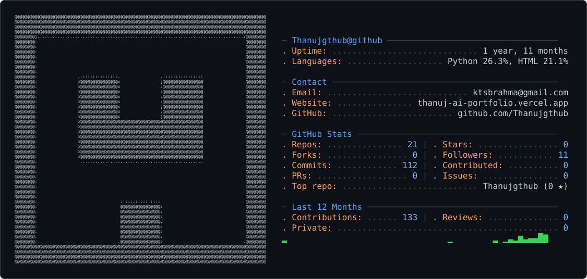
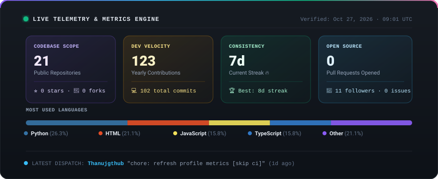

<picture>
  <source media="(prefers-color-scheme: dark)" srcset="dark_mode.svg" />
  <source media="(prefers-color-scheme: light)" srcset="light_mode.svg" />
  
</picture>

  

 

---

## 💡 ABOUT ME

I'm **Thanuj Sai Brahma Kodapaka**, and I build **AI applications**, **document search tools**, and **interactive web experiences**.

My projects include **Telugu handwriting recognition**, a **college document assistant**, and tools for learning **networking and algorithms**. I work with **Python**, **TypeScript**, **Java**, and **Flutter** to turn ideas into working applications.

---

## ⚡ LIVE SYSTEM TELEMETRY

  ⚡ Telemetry metrics are automatically updated via GitHub Actions &amp; GraphQL API with zero third-party service dependencies.

 

---

## 🚀 FEATURED INNOVATIONS

<table width="100%">
  <tr>
<td width="50%" valign="top">

### 🔤 [Akshara OCR](https://github.com/Thanujgthub/akshara-ocr)

**Telugu Handwriting Recognition & Review Studio**

Adapted **IndicOCR** for Telugu handwriting and evaluated it on **3,000 held-out word images**, reaching **76.20% exact-word match**. The studio supports reviewing predictions and exporting text, Markdown, and JSON.

</td>

<td width="50%" valign="top">

### 🎓 [CampusAI](https://github.com/Thanujgthub/CampusAI)

**College Document Assistant with Source Citations**

Answers questions from college documents using **retrieval-augmented generation**. Built with **FastAPI**, **Next.js**, and **PostgreSQL / pgvector**, with streaming responses, source citations, and student and administrator roles.

</td>
  </tr>

  <tr>
<td width="50%" valign="top">

### 🌐 [SubnetScope](https://github.com/Thanujgthub/subnet-reconnaissance-visualizer)

**Interactive IPv4 Subnetting & TCP Learning Tool**

Explains subnet calculations and TCP connection outcomes through an **interactive network topology** and **deterministic simulations**. Includes a separate, restricted local scanner for authorized lab use.

</td>

<td width="50%" valign="top">

### 🎹 [Pocket Piano](https://github.com/Thanujgthub/pocket_piano)

**Flutter Piano for Mobile & Web**

A responsive piano with **24 keys**, computer keyboard shortcuts, **four waveforms**, and volume and sustain controls. Built with **Flutter and Dart** for Android, iOS, and the web.

</td>
  </tr>

  <tr>
<td colspan="2" valign="top">

### 🗺️ [AI Audio Travel Guide](https://github.com/Thanujgthub/travel-guide)

**AI Travel Guides with Generated Narration**

Generates audio travel guides for Indian landmarks using **Gemini AI** and **Murf text-to-speech**. Combines a **Flask API** with a web interface for exploring destinations and listening to narration.

</td>
  </tr>
</table>

 

---

## 🛠️ TECHNICAL ARSENAL

<table width="100%">
  <tr>
<td width="25%" valign="top">

### 🧠 AI & ML

- PyTorch & LoRA
- IndicOCR Adaptation
- Gemini API
- Retrieval-Augmented Generation
- Vector Search & Embeddings
- Text-to-Speech APIs

</td>
<td width="25%" valign="top">

### 💻 Full-Stack Web

- Next.js & React
- TypeScript & JavaScript
- FastAPI & Python
- Flask
- Tailwind CSS
- REST APIs & Streaming

</td>
<td width="25%" valign="top">

### ⚡ Systems & Development

- Data Structures & Algorithms
- Java & Python
- IPv4 Subnetting & TCP
- Flutter & Dart
- GitHub Actions
- Git & Version Control

</td>
<td width="25%" valign="top">

### 📊 Databases & Cloud

- PostgreSQL
- pgvector
- SQLAlchemy
- Docker
- Vercel
- Hugging Face

</td>
  </tr>
</table>

 

---

## 📈 GITHUB STATS & OVERVIEW

 

---

## 👾 PAC-MAN CONTRIBUTIONS

<picture>
  <source
    media="(prefers-color-scheme: dark)"
    srcset="https://raw.githubusercontent.com/Thanujgthub/Thanujgthub/output/pacman-contribution-graph-dark.svg"
  />
  <source
    media="(prefers-color-scheme: light)"
    srcset="https://raw.githubusercontent.com/Thanujgthub/Thanujgthub/output/pacman-contribution-graph.svg"
  />
  
</picture>

 

---

## 🤝 LET'S CONNECT & COLLABORATE

If you want to discuss AI applications, document search, Telugu OCR,
or a project we could build together, feel free to get in touch!

  

Profile visuals refresh automatically with Python &amp; GitHub Actions. Visual layout adapted from <a href="https://github.com/shashanthnetha/shashanthnetha">shashanthnetha</a>.

